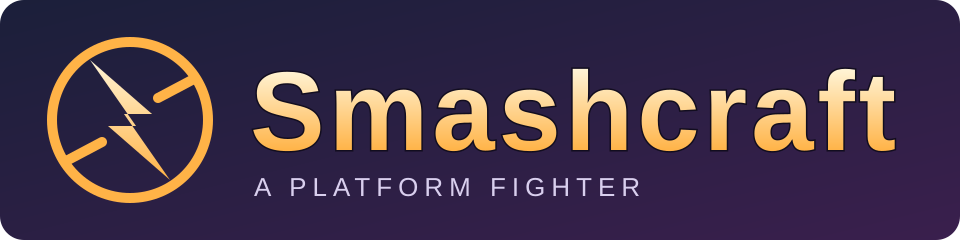

# Smashcraft

<p align="center">
  
</p>

Smashcraft is an in-development platform fighter for Warcraft III, inspired by
Super Smash Bros. Melee. Warcraft heroes fight on floating stages with jumps,
air dodges, shields, hitstun, knockback and stocks, over rollback netcode.

Warcraft III is still a great platform for custom games, and Melee's movement and
combat remain the model for the platform fighter. Smashcraft brings that
depth to Warcraft III's heroes, with the rollback netcode that online play needs.

Download the map from [Hive Workshop](https://www.hiveworkshop.com/)
(the link is a placeholder until the Smashcraft upload is available).
How to play: [player guide](docs/player-guide.md).
The GitHub repositories contain code only; maps are distributed on Hive Workshop,
not committed to Git or attached to GitHub releases.
The desktop client (controller, play, history, stats, replays, online) is
[smashcraft-client](https://github.com/tompassarelli/smashcraft-client); it
reads Smashcraft through the [client interface](docs/client-interface.md).
Status and next work: [roadmap #16](https://github.com/tompassarelli/smashcraft/issues/16).

## Principles

Smashcraft is an independent fan game inspired by Super Smash Bros. Melee, not
affiliated with or endorsed by Blizzard Entertainment or Nintendo. It is
built with our own code and animations on Warcraft III's unit models, alongside
the community model credited below. The map plays only inside your own copy of
Warcraft III; it never replaces the game.

- **Respect copyright and publisher IP.** The map uses Warcraft III's own
  models with animations we authored. The repositories contain no extracted
  Blizzard files: models, textures, sounds, data, scripts or in-game text.
  Build inputs stay private, outside Git, and Nintendo's code and assets are
  neither in the repositories nor shipped with Smashcraft.
- **Learn by observation.** Behaviour is measured from the outside: what
  Warcraft III shows, plays, logs and writes, and the traffic of LAN games we
  host, plus public documentation. Melee's feel comes from public frame data
  (SmashWiki, Smashboards) and from watching the game, never from the community
  decompilation or Melee's own files. Never from disassembly, decompilation or
  a game's memory. Gameplay facts are written as our own design targets, citing
  public sources where they exist.
- **Play fair.** No DRM bypass, no Battle.net emulation, no cheats, and nothing
  that touches other players or Blizzard's services.
- **Original work.** Our own code only. No code from AGPL projects such as
  Warsmash, and "Warcraft" stays out of our product names.

The long form, with what counts as observation and how the checks enforce it,
is Wisp's [clean-room rules](https://github.com/tompassarelli/wisp/blob/main/docs/clean-room.md).

## Develop

Smashcraft is written in TypeScript on [Wisp](https://github.com/tompassarelli/wisp),
which compiles it to Warcraft III's Lua. From [smashcraft:ts/](ts/):

```sh
bun install --frozen-lockfile
bun wisp dev
```

Keep `bun wisp dev` running: every save reports type errors, affected tests
and simulated matches. Building the playable map also needs a locally
installed Warcraft III and private game assets, which are not in this
repository.

Where to look next:

- [AGENTS.md](AGENTS.md): repository rules and task routers; from ts/, run `bun wisp help` for commands.
- [Documentation index](docs/README.md): how the game and its systems work.
- [Wisp feature index](https://github.com/tompassarelli/wisp/blob/main/docs/index.md):
  framework capabilities and opt-in diagnostics.

## Credits

The [Lich King model by Kwaliti](https://www.hiveworkshop.com/threads/the-lich-king.154837/)
(Hive Workshop), used with credit as the author permits. Kwaliti's
[usage terms](https://www.hiveworkshop.com/profile-posts/951524/) allow free use
and require credit to Kwaliti and Hive Workshop as the original source.
[Model credits and source terms](docs/design/roster.md#credits) record the details.

## License

Smashcraft is released under the [MIT License](LICENSE). The vendored Effect
source under repos/effect/ keeps its own MIT license. Warcraft III, Super Smash
Bros. Melee and their assets belong to their owners and are not part of this
repository; reference values cite their sources.

<small>Warcraft and Blizzard Entertainment are trademarks or registered trademarks of Blizzard
Entertainment, Inc. Nintendo and Super Smash Bros. Melee are trademarks of Nintendo.</small>
